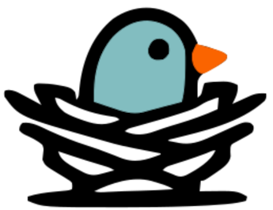
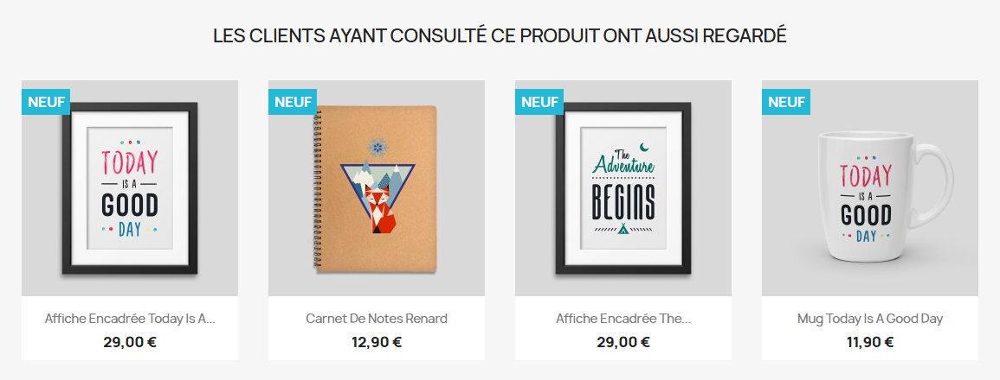
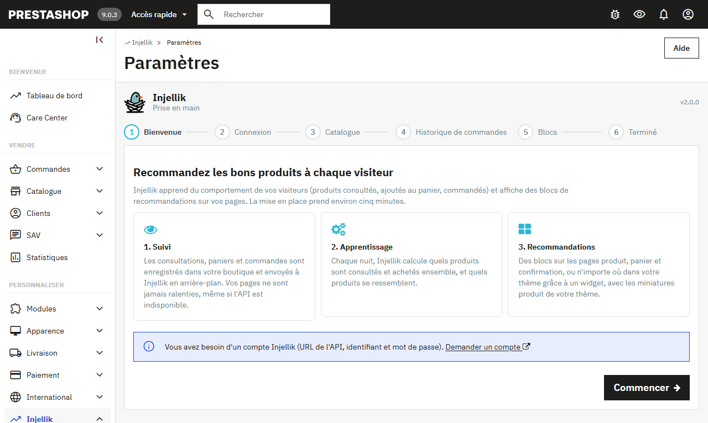
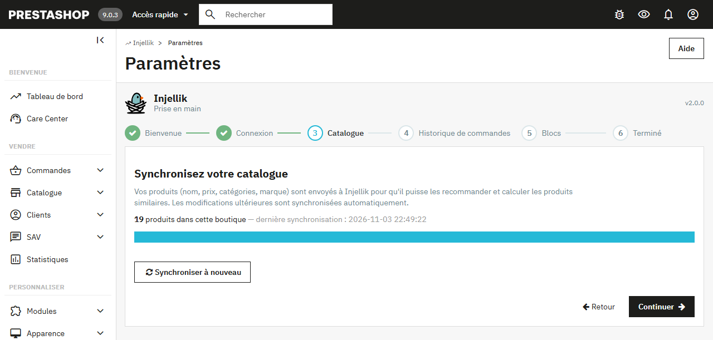
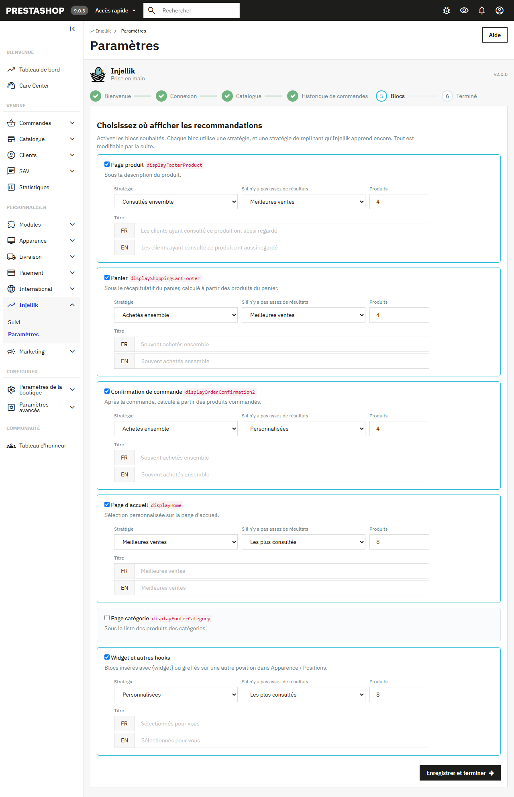
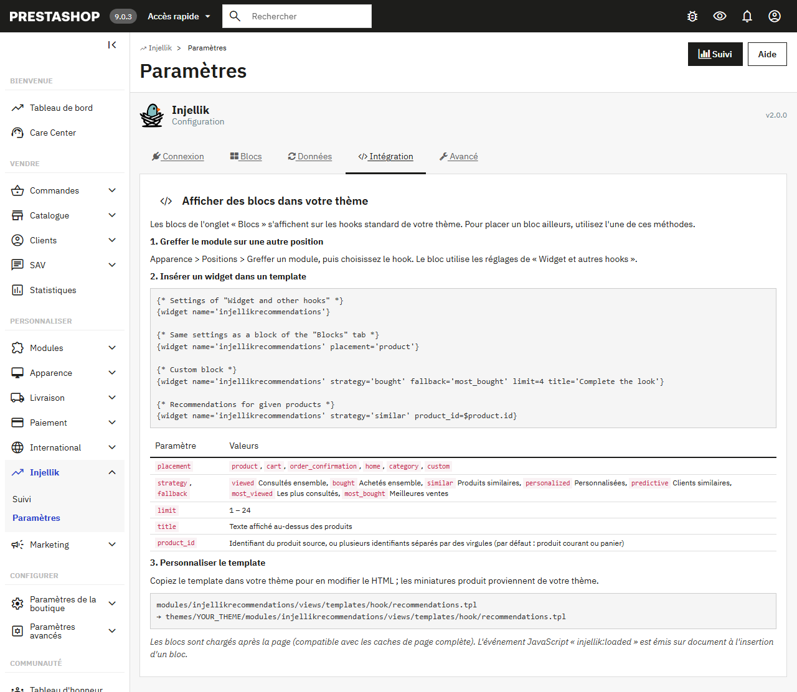
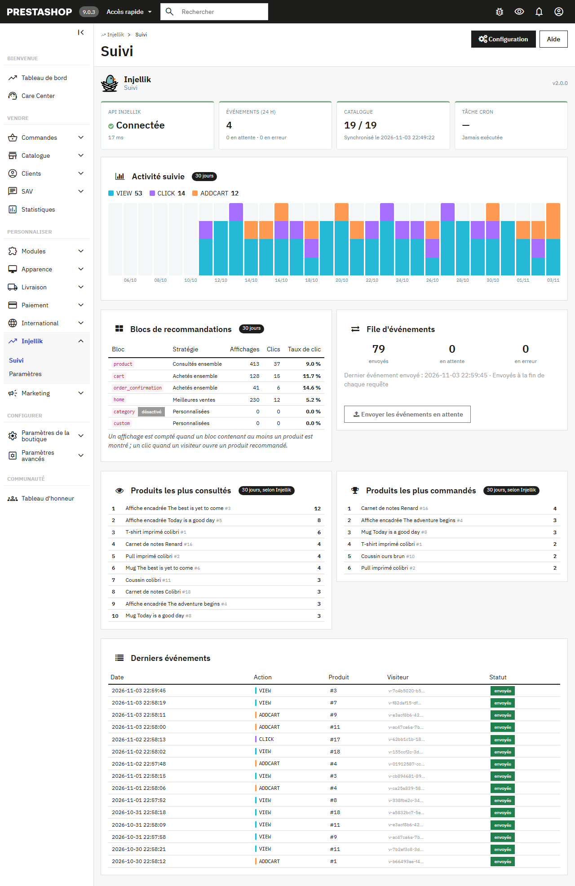

<h1 align="center">
  <br>
  Injellik Recommendations pour PrestaShop
</h1>

<p align="center">
  Recommandations de produits personnalisées, calculées à partir du comportement réel de vos visiteurs.
</p>

<p align="center">
  <a href="https://github.com/guillaumemonet/injellik-prestashop/actions/workflows/ci.yml"></a>
  <a href="https://github.com/guillaumemonet/injellik-prestashop/releases/latest"></a>
  
  
  <a href="LICENSE"></a>
</p>

<p align="center">
  
</p>

Ce module connecte votre boutique à l'API **[Injellik](https://www.web-nest.fr/injellik)**. Il suit ce que font vos visiteurs (produits consultés, ajoutés au panier, commandés), l'envoie à Injellik qui en déduit chaque nuit les produits **consultés ensemble**, **achetés ensemble** et **similaires**, puis affiche des blocs de recommandations sur vos pages, avec les miniatures produit de votre thème.

## Sommaire

- [Fonctionnalités](#fonctionnalités)
- [Prérequis](#prérequis)
- [Installation](#installation)
- [Démarrage rapide](#démarrage-rapide)
- [Afficher des recommandations](#afficher-des-recommandations)
- [Données collectées](#données-collectées)
- [Tâche cron](#tâche-cron)
- [Page de suivi](#page-de-suivi)
- [Configuration avancée](#configuration-avancée)
- [Mise à jour depuis la version 2.0](#mise-à-jour-depuis-la-version-20)
- [Mise à jour depuis la version 1.x](#mise-à-jour-depuis-la-version-1x)
- [Dépannage](#dépannage)
- [Développement](#développement)

## Fonctionnalités

- **Assistant d'installation** en six étapes : connexion, synchronisation du catalogue, import de l'historique de commandes, choix des blocs.
- **Six emplacements prêts à l'emploi** : fiche produit, panier, confirmation de commande, accueil, catégorie, plus un emplacement générique pour les widgets et les autres hooks.
- **Sept stratégies** : consultés ensemble, achetés ensemble, produits similaires, personnalisées, clients similaires, les plus consultés, meilleures ventes. Chaque bloc a une stratégie de repli tant qu'Injellik apprend encore.
- **Intégration libre** : `{widget name='injellikrecommendations'}` dans n'importe quel template, greffe sur n'importe quel hook, template surchargeable par le thème.
- **Aucun impact sur les performances** :
  - les blocs se chargent après la page, ce qui les rend compatibles avec les caches de page complète ;
  - les événements passent par une file locale et sont envoyés après la réponse.
- **Résilient** : une API lente ou indisponible, ou un abonnement suspendu, ne ralentit ni ne casse jamais la boutique, y compris la validation des commandes. Les événements sont renvoyés automatiquement.
- **Page de suivi** : état de l'API, activité, taux de clic par bloc, file d'événements, produits phares.
- **Respect de la vie privée** : les visiteurs sont identifiés par des identifiants pseudonymes, aucune donnée personnelle ne quitte la boutique.
- **Multiboutique** (une clé de licence par boutique) et **multilingue** (titres par langue, interface en français et en anglais).

## Prérequis

| | Version |
|---|---|
| PrestaShop | 8.0 à 9.x (testé sur 8.2 avec le thème Classic et sur 9.0 avec Hummingbird) |
| PHP | 7.2.5 à 8.4, extension cURL |
| Licence | une clé de licence Injellik, obtenue avec un abonnement sur [web-nest.fr](https://web-nest.fr/#tarifs) |

Un thème compatible PrestaShop 8 (qui fournit `catalog/_partials/productlist.tpl`) affiche les blocs sans adaptation.

## Installation

1. Téléchargez **`injellikrecommendations-x.y.z.zip`** depuis la [dernière release](https://github.com/guillaumemonet/injellik-prestashop/releases/latest). Ce lien direct mène toujours à la dernière version : [`injellikrecommendations.zip`](https://github.com/guillaumemonet/injellik-prestashop/releases/latest/download/injellikrecommendations.zip).
   > N'utilisez pas « Download ZIP » de GitHub : cette archive contient tout le dépôt, et non le seul dossier du module.
2. Dans le back-office, ouvrez **Modules > Gestionnaire de modules > Installer un module** et déposez le zip.
3. Cliquez sur **Configurer** : l'assistant démarre.

En ligne de commande :

```bash
unzip injellikrecommendations-x.y.z.zip -d /chemin/vers/prestashop/modules/
php bin/console prestashop:module install injellikrecommendations
```

## Démarrage rapide

L'assistant vous guide en six étapes. Le module ajoute ensuite le menu **Injellik** (section *Personnaliser*), avec les pages **Suivi** et **Paramètres**.

<p align="center"></p>

| Étape | Ce qui se passe |
|---|---|
| **Connexion** | La clé de licence de la boutique (`ijk_lic_…`), affichée dans votre compte web-nest.fr ([Mon compte > Boutiques](https://web-nest.fr/mon-compte/boutiques/)). Le bouton « Tester la connexion » vérifie que l'API répond et accepte la clé. |
| **Catalogue** | Les produits sont envoyés par lots de 100, avec une barre de progression. |
| **Historique** | Import facultatif des commandes passées depuis une date donnée. Les recommandations « achetés ensemble » sont ainsi disponibles dès le prochain entraînement, sans attendre des semaines de suivi. |
| **Blocs** | Choix des emplacements, des stratégies, du nombre de produits et des titres. |

> **Compte créé avant les abonnements ?** Le lien « Utiliser un identifiant API », sous le formulaire, ouvre l'ancienne connexion (URL de l'API, identifiant et mot de passe). Les installations existantes l'utilisent automatiquement.

<p align="center"></p>

> **Quand les recommandations apparaissent-elles ?** Le suivi commence immédiatement. Injellik entraîne ses modèles chaque nuit. D'ici là, les blocs utilisent leur stratégie de repli (meilleures ventes, produits similaires…). Ils ne sont donc jamais vides si la boutique a déjà des ventes.

## Afficher des recommandations

### Emplacements intégrés

| Emplacement | Hook | Produits sources | Par défaut |
|---|---|---|---|
| Page produit | `displayFooterProduct` | produit affiché | ✅ consultés ensemble → similaires |
| Panier | `displayShoppingCartFooter` | produits du panier | ✅ achetés ensemble → meilleures ventes |
| Confirmation de commande | `displayOrderConfirmation2` | produits commandés | ✅ achetés ensemble → personnalisées |
| Page d'accueil | `displayHome` | historique du visiteur | ❌ personnalisées → les plus consultés |
| Page catégorie | `displayFooterCategory` | historique du visiteur | ❌ personnalisées → les plus consultés |
| Widget et autres hooks | au choix | produit affiché ou panier | ✅ personnalisées → les plus consultés |

<p align="center"></p>

### Stratégies

| Code | Nom | Principe | Endpoint de l'API |
|---|---|---|---|
| `viewed` | Consultés ensemble | produits vus dans les mêmes sessions | `GET /api/recommendations/viewed/{sku}` |
| `bought` | Achetés ensemble | produits commandés ensemble | `GET /api/recommendations/bought/{sku}` |
| `similar` | Produits similaires | catégories, marque et prix proches | `GET /api/related/{sku}` |
| `personalized` | Personnalisées | d'après l'activité récente du visiteur | `GET /api/recommendations/user/{uuid}` |
| `predictive` | Clients similaires | ce qu'ont acheté les clients aux achats proches | `POST /api/recommendations/predictive` |
| `most_viewed` | Les plus consultés | 30 derniers jours | `GET /api/community-rankings/most-viewed` |
| `most_bought` | Meilleures ventes | 30 derniers jours | `GET /api/community-rankings/most-bought` |

Le module complète la liste avec la stratégie de repli si la première ne renvoie pas assez de produits. Il retire :

- les produits sources ;
- les produits inactifs ou invisibles dans le catalogue ;
- les produits épuisés qui ne peuvent pas être commandés (option).

### Widget

Le widget s'insère dans n'importe quel template du thème :

```smarty
{* Réglages de l'emplacement « Widget et autres hooks » *}
{widget name='injellikrecommendations'}

{* Mêmes réglages qu'un emplacement intégré *}
{widget name='injellikrecommendations' placement='product'}

{* Bloc entièrement personnalisé *}
{widget name='injellikrecommendations' strategy='bought' fallback='most_bought' limit=4 title='Complétez le look'}

{* Recommandations pour des produits donnés *}
{widget name='injellikrecommendations' strategy='similar' product_id=$product.id}
{widget name='injellikrecommendations' strategy='viewed' product_id='12,34,56'}
```

| Paramètre | Valeurs | Défaut |
|---|---|---|
| `placement` | `product`, `cart`, `order_confirmation`, `home`, `category`, `custom` | `custom` |
| `strategy` | un code de stratégie | celui de l'emplacement |
| `fallback` | un code de stratégie, ou `''` pour aucun repli | celui de l'emplacement |
| `limit` | 1 à 24 | celui de l'emplacement |
| `title` | texte | titre de l'emplacement |
| `product_id` | un id ou plusieurs ids séparés par des virgules | produit affiché, sinon panier |

Un widget qui précise `placement` s'affiche même si cet emplacement est désactivé : seuls les hooks automatiques respectent l'activation.

### Sur un autre hook

**Apparence > Positions > Greffer un module** : choisissez *Injellik Recommandations* puis le hook. Le bloc utilise les réglages de « Widget et autres hooks ».

<p align="center"></p>

### Personnaliser le rendu

Le bloc reprend la liste de produits du thème (`catalog/_partials/productlist.tpl`). Pour modifier son HTML, copiez le template dans votre thème :

```
modules/injellikrecommendations/views/templates/hook/recommendations.tpl
  → themes/<votre-thème>/modules/injellikrecommendations/views/templates/hook/recommendations.tpl
```

Gardez l'attribut `data-injellik-placement` sur l'élément racine et `data-id-product` sur les miniatures : ce sont eux qui permettent de mesurer les clics.

Les blocs sont chargés **en asynchrone**. La page contient un emplacement signé, que `views/js/front.js` remplace lorsqu'il approche de la zone visible. Après chaque insertion, un événement est émis sur `document` :

```js
document.addEventListener('injellik:loaded', (event) => {
  const { element, placement } = event.detail; // initialiser un carrousel, etc.
});
```

## Données collectées

| Action | Déclencheur |
|---|---|
| `VIEW` | affichage d'une fiche produit |
| `ADDCART` | ajout d'un produit au panier |
| `BUY` | validation d'une commande (un événement par produit) |
| `CLICK` | clic sur un produit recommandé |

Chaque événement contient le type d'action, l'id produit et deux identifiants pseudonymes :

- **`user_uuid`** :
  - pour un client connecté, une empreinte de son id (`c-…`), calculée avec la clé secrète de la boutique et non réversible ;
  - sinon, un identifiant aléatoire conservé dans le cookie PrestaShop (`v-…`).
- **`user_session_uuid`** : identifiant de la visite, renouvelé après 30 minutes d'inactivité et après chaque commande. Une commande validée hors de la navigation du client (notification de paiement, commande saisie au back-office) a sa propre session, `order-<id>`.

Les sessions servent de base à la facturation de l'abonnement : aucune n'est créée pour les robots (quand l'option « Ignorer les robots » est active) ni pour une requête sans cookie.

**Ne sont jamais envoyés** : nom, e-mail, adresse, IP ou contenu des commandes (montants, adresses).

Pour le catalogue, le module envoie pour chaque produit :

- l'id (le SKU côté Injellik), le nom, le résumé, le prix TTC et l'EAN ;
- un champ `enabled`, à faux si le produit est inactif ou invisible ;
- un `profile` (catégories, marque, prix) qui alimente le calcul des produits similaires.

Les produits créés, modifiés ou supprimés sont synchronisés automatiquement, en un seul appel par requête, y compris pendant un import CSV.

**File locale.** Les hooks n'appellent jamais l'API : ils écrivent une ligne dans `ps_injellik_event`. Les événements partent ensuite :

- **à la fin de la requête** (par défaut) : avec PHP-FPM ou LiteSpeed, une fois la page envoyée au visiteur. Sans eux (Apache mod_php), le navigateur demande l'envoi juste après, par une requête en arrière-plan que personne n'attend ;
- **ou par la tâche cron**.

Le visiteur n'attend jamais l'API, même lorsqu'elle est lente ou injoignable. Une erreur du module est consignée dans les journaux de PrestaShop (**Paramètres avancés > Logs**) et n'interrompt jamais la page, le panier ou la commande.

En cas d'erreur réseau ou serveur, un événement est retenté jusqu'à 5 fois. Les événements envoyés sont purgés après 30 jours. Les visites des robots sont ignorées.

## Tâche cron

Elle est recommandée. L'URL, avec son jeton, se trouve dans **Paramètres > Données** :

```cron
# Envoi des événements en attente, purge (toutes les 10 minutes)
*/10 * * * * curl -s "https://votre-boutique.fr/module/injellikrecommendations/cron?token=XXXX" > /dev/null

# Synchronisation complète du catalogue (facultatif, chaque nuit)
30 2 * * *   curl -s "https://votre-boutique.fr/module/injellikrecommendations/cron?token=XXXX&task=catalog" > /dev/null
```

Pour que le jeton n'apparaisse pas dans les journaux d'accès du serveur, il peut aussi être passé dans un en-tête :

```cron
*/10 * * * * curl -s -H "X-Injellik-Token: XXXX" "https://votre-boutique.fr/module/injellikrecommendations/cron" > /dev/null
```

La réponse est un JSON, par exemple `{"events":{"sent":12,"failed":0,"pending":0},"purged":3}`. Si l'API refuse la boutique, elle contient aussi `"api":"suspended"` ou `"api":"invalid_key"`.

## Page de suivi

<p align="center"></p>

- **Santé** : connexion et latence de l'API, événements des dernières 24 h, état du catalogue, dernier passage du cron, dernière erreur.
- **Activité suivie** : événements par jour et par type sur 30 jours.
- **Blocs de recommandations** : affichages, clics et taux de clic par emplacement.
- **File d'événements** : envoyés, en attente, en erreur, avec deux boutons (envoyer maintenant, renvoyer les erreurs).
- **Classements** : produits les plus consultés et les plus commandés selon Injellik.
- **Derniers événements**, avec leur statut.

<sub>Captures réalisées sur une boutique de démonstration avec des données simulées.</sub>

## Configuration avancée

Ces réglages se trouvent dans **Paramètres > Avancé**.

| Réglage | Défaut | Détail |
|---|---|---|
| URL de l'API | `https://injellik.web-nest.fr` | À ne modifier que sur demande de Web-Nest. |
| Affichage des blocs | Asynchrone | « Dans la page » appelle l'API pendant la génération de la page : les blocs sont visibles sans JavaScript, mais la page est plus lente. |
| Envoi des événements | Fin de requête | Choisissez « Tâche cron uniquement » si PHP tourne en mod_php sous Apache. |
| Délai d'attente de l'API | 3 s | Pour les appels du front. Le back-office et le cron attendent jusqu'à 20 s. |
| Cache des recommandations | 900 s | Cache fichier dans `var/cache/<env>/injellik`. Les recommandations personnalisées sont gardées 60 s au maximum. |
| Masquer les produits épuisés | oui | Seulement si la gestion des stocks est active. |
| Ignorer les robots | oui | Filtre sur le user-agent. |
| Synchronisation automatique | oui | Envoie un produit à son enregistrement. |

**Multiboutique** : sélectionnez une boutique dans le sélecteur multiboutique avant de la configurer. Chaque boutique a sa propre clé de licence, et les événements comme les statistiques sont séparés par boutique.

## Mise à jour depuis la version 2.0

Installez le nouveau zip par-dessus l'ancien module : l'identifiant et le mot de passe configurés continuent de fonctionner, sans action de votre part. Le script `upgrade/upgrade-2.1.0.php` renseigne l'URL de l'API si elle est vide et enregistre le hook de l'alerte d'abonnement.

Pour passer à la clé de licence, ouvrez **Paramètres > Connexion**, cliquez sur « Utiliser une clé de licence », collez la clé et enregistrez.

## Mise à jour depuis la version 1.x

Installez le nouveau zip par-dessus l'ancien module. Le script `upgrade/upgrade-2.0.0.php` :

- conserve l'URL et les identifiants de l'API (une URL se terminant par `/api` est corrigée) ;
- crée les tables, les nouveaux hooks et le menu.

L'assistant s'ouvre à la visite suivante de la configuration : relancez la synchronisation du catalogue et, si besoin, l'import des commandes.

## Dépannage

| Symptôme | Piste |
|---|---|
| « Tester la connexion » échoue | Vérifiez la clé de licence (ou l'identifiant et le mot de passe), l'URL de l'API dans **Paramètres > Avancé** (sans `/api`), et que le serveur de la boutique peut joindre l'API (pare-feu sortant). |
| « Votre abonnement Injellik est suspendu » | Le paiement de l'abonnement a échoué. Régularisez-le sur [Mon compte > Abonnement](https://web-nest.fr/mon-compte/abonnement/). En attendant, les blocs sont masqués et les événements sont conservés dans la boutique. Le module vérifie de nouveau toutes les 15 minutes, et à chaque enregistrement de la configuration ; tout repart seul dès que l'abonnement est réactivé. |
| « Clé de licence invalide ou révoquée » | La clé a été mal copiée, régénérée ou supprimée. Copiez la clé actuelle de la boutique depuis [Mon compte > Boutiques](https://web-nest.fr/mon-compte/boutiques/) et enregistrez-la dans **Paramètres > Connexion**. |
| Aucun bloc ne s'affiche | Le thème doit appeler le hook (`displayFooterProduct`…). Vérifiez dans **Apparence > Positions** que le module y est greffé et que l'emplacement est activé. Un bloc sans produit à afficher est retiré de la page. |
| Les blocs n'utilisent que la stratégie de repli | C'est normal tant que l'API n'a pas été entraînée sur assez de données (au moins deux sessions communes pour « consultés ensemble »). |
| Des événements restent « en attente » | Consultez la dernière erreur sur la page de suivi, puis planifiez la tâche cron. Après une suspension, la tâche cron envoie les événements conservés. |
| Les boutons « liste d'envies » manquent sur les miniatures | Les modules qui initialisent les miniatures au chargement de la page doivent écouter l'événement `injellik:loaded`. |

## Développement

```bash
docker compose up -d                                   # PrestaShop 8.2 sur http://localhost:8090, module monté
PS_VERSION=9.0 PS_PORT=8091 docker compose -p injellik-ps9 up -d   # PrestaShop 9 en parallèle
docker compose exec prestashop php bin/console prestashop:module install injellikrecommendations
./build.sh                                             # → dist/injellikrecommendations-<version>.zip
```

Back-office : `/admin-dev`, `demo@prestashop.com` / `prestashop_demo`. Une API lancée sur la machine hôte est joignable depuis le conteneur à l'adresse `http://host.docker.internal:<port>`.

```
injellikrecommendations/
├── injellikrecommendations.php      Module : hooks de suivi, widget
├── classes/
│   ├── InjellikApiClient.php        Client HTTP (clé de licence, ou JWT en cache renouvelé sur 401)
│   ├── InjellikConfig.php           Configuration, emplacements, stratégies
│   ├── InjellikEventQueue.php       File locale et envoi des événements
│   ├── InjellikIdentity.php         Identifiants visiteur et session
│   ├── InjellikRecommender.php      Recommandations, filtres, rendu
│   ├── InjellikSync.php             Catalogue et historique de commandes
│   ├── InjellikStats.php            Affichages, clics, agrégats
│   ├── InjellikCache.php            Cache fichier
│   └── InjellikInstaller.php        Tables, hooks, onglets
├── controllers/admin/               Paramètres (+ assistant) et Suivi
├── controllers/front/               recommendations (rendu AJAX), track (clics), cron
├── translations/fr-FR/              Modules.Injellikrecommendations.Admin / .Shop
├── upgrade/                         Scripts de mise à jour
└── views/                           Templates, JS, CSS
```

La CI (`.github/workflows/ci.yml`) :

1. vérifie la syntaxe sous PHP 7.2, 7.4, 8.1, 8.3 et 8.4 ;
2. installe le module sur PrestaShop 8.2 et 9.0 et contrôle hooks et onglets ;
3. construit le zip et l'attache à la release GitHub pour chaque tag `v*`.

**Publier une version.**

1. Mettez à jour `$this->version` dans `injellikrecommendations.php` et `InjellikApiClient::VERSION`.
2. Ajoutez si besoin `upgrade/upgrade-x.y.z.php`.
3. Complétez `CHANGELOG.md`.
4. Lancez `git tag vx.y.z && git push origin vx.y.z`.

## Licence

[Academic Free License 3.0](LICENSE) — © Web-Nest
